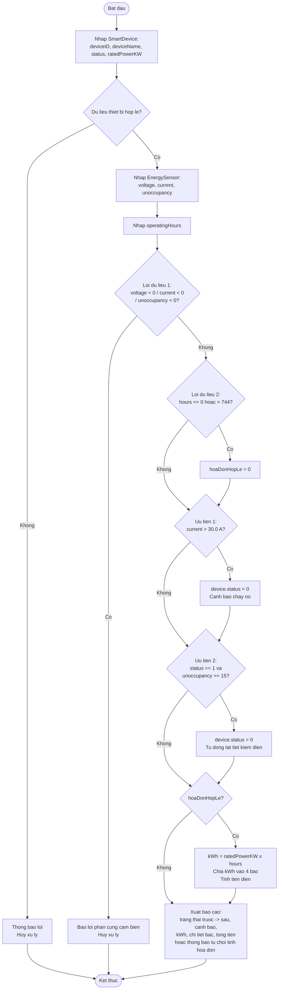

# Rikkei SmartHome – Smart Gateway: Báo cáo phân tích & thiết kế giải pháp

Module điều khiển trung tâm chạy trên Smart Gateway. Chương trình ghi nhận dữ liệu từ thiết bị điện và cảm biến, rồi thực hiện ba việc:

- ngắt khẩn cấp khi dòng điện quá tải;
- tự động tắt thiết bị khi phòng trống;
- tính tiền điện dự kiến theo biểu giá bậc thang EVN.

Mã nguồn: `main.c` (ANSI C / C11, chỉ dùng hàm `main()`, không dùng mảng cấu trúc, truy xuất struct qua toán tử `.`).

---

## 1. Phân tích bài toán (Input / Output)

### 1.1. Dữ liệu đầu vào

**Cấu trúc `SmartDevice` – thiết bị thông minh**

| Trường | Kiểu | Ý nghĩa | Ràng buộc kiểm tra |
|---|---|---|---|
| `deviceID` | `int` | Mã định danh thiết bị | Phải là số nguyên |
| `deviceName` | `char[50]` | Tên thiết bị (có khoảng trắng, nhập bằng `fgets`) | Không rỗng |
| `status` | `int` | 1: đang bật, 0: đã tắt | Chỉ nhận 0 hoặc 1 |
| `ratedPowerKW` | `float` | Công suất định mức (kW) | > 0 |

**Cấu trúc `EnergySensor` – cảm biến điện năng & hiện diện**

| Trường | Kiểu | Ý nghĩa | Ràng buộc kiểm tra (Lỗi dữ liệu 1) |
|---|---|---|---|
| `voltageVolts` | `float` | Điện áp đo được (V) | ≥ 0 |
| `currentAmperes` | `float` | Dòng điện đo được (A) | ≥ 0 |
| `unoccupancyMinutes` | `int` | Thời gian vắng người (phút) | ≥ 0 |

**Biến phụ trợ**

| Biến | Kiểu | Ý nghĩa |
|---|---|---|
| `operatingHours` | `float` | Số giờ vận hành trong tháng do người dùng nhập. Ràng buộc 0 < giờ ≤ 744 (Lỗi dữ liệu 2) |
| `statusBanDau` | `int` | Trạng thái trước khi áp dụng luật, dùng để báo cáo "trước → sau" |
| `canhBaoQuaTai`, `daTuDongTat` | `int` (cờ 0/1) | Ghi nhận luật tự động nào đã kích hoạt |
| `hoaDonHopLe` | `int` (cờ 0/1) | 0 nghĩa là từ chối tính hóa đơn |
| `kWh`, `kWhBac1..4`, `tienDien` | `double` | Điện năng, phần kWh rơi vào từng bậc, tổng tiền |

**Hằng số nghiệp vụ:**

- Ngưỡng dòng điện 30.0 A.
- Ngưỡng vắng người 15 phút.
- Số giờ tối đa trong tháng 744 (31 × 24).
- Giá các bậc EVN: 1.806 / 1.866 / 2.167 / 2.729 VNĐ/kWh.

### 1.2. Kết quả đầu ra

1. **Trạng thái thiết bị** sau khi áp dụng luật tự động hóa, dạng `DANG BAT -> DA TAT`.
2. **Thông báo cảnh báo (nếu có):**
   - Cảnh báo nguy cơ cháy nổ và ngắt khẩn cấp khi dòng > 30 A;
   - Thông báo tự động tắt để tiết kiệm năng lượng khi phòng trống ≥ 15 phút.
3. **Tổng điện năng tiêu thụ (kWh)** cùng chi tiết từng bậc giá.
4. **Tổng tiền điện phải trả** (chưa VAT), làm tròn đến đồng.
5. **Thông báo lỗi** khi dữ liệu cảm biến bất thường (hủy xử lý) hoặc số giờ vận hành không hợp lệ (từ chối tính hóa đơn).

---

## 2. Đề xuất giải pháp – tư duy dùng toán tử `.`

Mỗi thực thể là **một biến struct độc lập**: `struct SmartDevice device;` và `struct EnergySensor sensor;`. Không dùng mảng cấu trúc, không dùng con trỏ. Mọi thao tác đọc và ghi đều đi thẳng vào thành viên bằng `.`.

**Nhập dữ liệu** – ghi trực tiếp vào thành viên:

```c
scanf("%f", &sensor.currentAmperes);
fgets(device.deviceName, sizeof(device.deviceName), stdin);
```

**Kiểm tra an toàn** – so sánh thành viên của cảm biến, rồi ghi vào thành viên của thiết bị. Đây là điểm kết nối hai struct:

```c
if (sensor.currentAmperes > NGUONG_DONG_DIEN) {
    device.status = 0;          /* ngat khan cap */
}
if (device.status == 1 && sensor.unoccupancyMinutes >= NGUONG_VANG_NGUOI) {
    device.status = 0;          /* tu dong tat */
}
```

Luật 2 đọc lại `device.status` **sau khi** luật 1 có thể đã ghi đè thành viên này. Nhờ đó thứ tự ưu tiên được bảo đảm: thiết bị đã bị ngắt vì quá tải thì không bị xử lý lần nữa, và cũng không bị báo nhầm là "tắt để tiết kiệm điện".

**Tính toán tài chính** – lấy thành viên `device.ratedPowerKW` làm toán hạng:

```c
kWh = (double)device.ratedPowerKW * operatingHours;
```

Tiền điện được tính lũy tiến: chỉ phần kWh vượt qua mốc của bậc trước mới chịu giá của bậc sau.

| kWh | Công thức tiền điện |
|---|---|
| ≤ 50 | `kWh × 1806` |
| 50 < kWh ≤ 100 | `50×1806 + (kWh − 50) × 1866` |
| 100 < kWh ≤ 200 | `50×1806 + 50×1866 + (kWh − 100) × 2167` |
| > 200 | `50×1806 + 50×1866 + 100×2167 + (kWh − 200) × 2729` |

Phép tính dùng `double` để tránh sai số tích lũy của `float` khi nhân với đơn giá lớn.

**Hai lưu ý về nghiệp vụ:**

- Hóa đơn là **ước tính cho cả tháng**, tính từ `ratedPowerKW × operatingHours` do người dùng nhập. Vì vậy nó không phụ thuộc trạng thái bật/tắt tại thời điểm đo.
- Điện áp chỉ được dùng để kiểm tra lỗi cảm biến và hiển thị, vì đề bài không đưa điện áp vào luật điều khiển.

---

## 3. Thiết kế các bước xử lý



**Diễn giải từng bước:**

1. **Nhập thông tin thiết bị.**
   - Sau mỗi lần `scanf` đều làm sạch bộ đệm bằng `while (getchar() != '\n');`, nhất là trước khi gọi `fgets` cho tên thiết bị.
   - Dữ liệu sai kiểu, `status` khác 0/1, hoặc công suất ≤ 0 thì báo lỗi và kết thúc.
2. **Nhập dữ liệu cảm biến và số giờ vận hành.**
3. **Kiểm tra Lỗi dữ liệu 1 (cảm biến bất thường).** Nếu bất kỳ thông số nào âm, chương trình liệt kê từng thông số lỗi, **hủy toàn bộ xử lý** và trả mã thoát 1. Không áp dụng luật tự động nào trên dữ liệu hỏng.
4. **Kiểm tra Lỗi dữ liệu 2 (giờ vận hành).** Nếu ngoài khoảng (0, 744], chương trình đánh dấu `hoaDonHopLe = 0`.
   - Luật an toàn vẫn được áp dụng, vì dữ liệu cảm biến hợp lệ.
   - Chỉ riêng phần hóa đơn bị từ chối.
5. **Ưu tiên 1 – An toàn điện.** Nếu `sensor.currentAmperes > 30.0` thì đặt `device.status = 0` và bật cờ cảnh báo cháy nổ.
6. **Ưu tiên 2 – Tiết kiệm năng lượng.** Nếu `device.status == 1` và `sensor.unoccupancyMinutes >= 15` thì đặt `device.status = 0`.
7. **Tính điện năng và chi phí** (chỉ khi hóa đơn hợp lệ): tính kWh, chia kWh vào 4 bậc, cộng dồn tiền điện.
8. **Xuất báo cáo:** thông tin thiết bị, cảm biến, cảnh báo, trạng thái trước → sau, chi tiết bậc giá, tổng tiền (có dấu chấm hàng nghìn).

---

## 4. Kiểm thử

Kết quả chạy thực tế với `gcc -std=c11 -Wall -Wextra -pedantic` (không có cảnh báo):

| # | Trường hợp | Đầu vào chính | Kết quả |
|---|---|---|---|
| TC01 | Quá tải dòng điện | Bật, 3.5 kW, 35 A, vắng 5 phút, 200 giờ | Cảnh báo cháy nổ, **ngắt khẩn cấp** BẬT → TẮT; 700 kWh → **1.764.800 VNĐ** |
| TC02 | Phòng trống | Bật, 1.5 kW, 7 A, vắng 20 phút, 100 giờ | **Tự động tắt** tiết kiệm điện; 150 kWh → **291.950 VNĐ** |
| TC03 | Ngay tại các ngưỡng | Bật, 2 kW, **30.0 A**, vắng **14 phút**, 20 giờ | Không cảnh báo, vẫn BẬT; 40 kWh (bậc 1) → **72.240 VNĐ** |
| TC04 | Lỗi dữ liệu 1 | Dòng điện = −3 A | Báo lỗi phần cứng cảm biến, **hủy xử lý** |
| TC05 | Lỗi dữ liệu 1 (nhiều trường) | Điện áp = −220 V, vắng người = −1 | Liệt kê cả 2 thông số lỗi, **hủy xử lý** |
| TC06 | Lỗi dữ liệu 2 | 800 giờ | Áp dụng luật bình thường, **từ chối tính hóa đơn** |
| TC07 | Lỗi dữ liệu 2 | 0 giờ | **Từ chối tính hóa đơn** |
| TC08 | Biên giờ vận hành | 0.5 kW, **744 giờ** | Hợp lệ; 372 kWh (đủ 4 bậc) → **869.688 VNĐ** |
| TC09 | Trạng thái sai | `status = 2` | Báo lỗi, hủy xử lý |

Kiểm tra tay TC01: 50×1806 + 50×1866 + 100×2167 + 500×2729 = 90.300 + 93.300 + 216.700 + 1.364.500 = **1.764.800 VNĐ**, khớp với kết quả chương trình.

---

## 5. Biên dịch & chạy

```bash
gcc -std=c11 -Wall -o main main.c
./main          # Windows: main.exe
```

Chương trình in tiếng Việt không dấu để hiển thị ổn định trên terminal Windows và VS Code.
